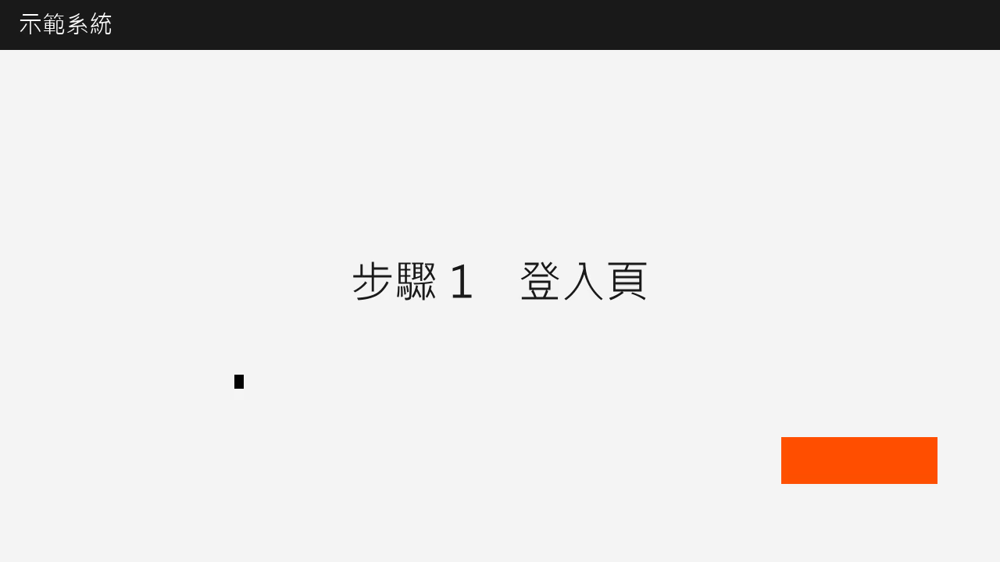
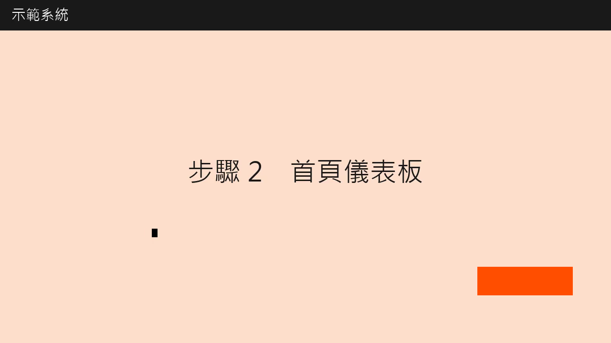
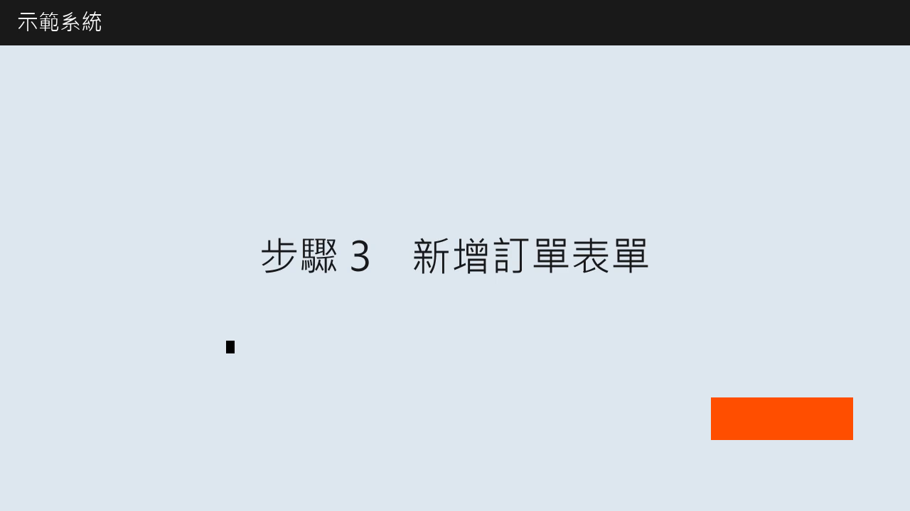
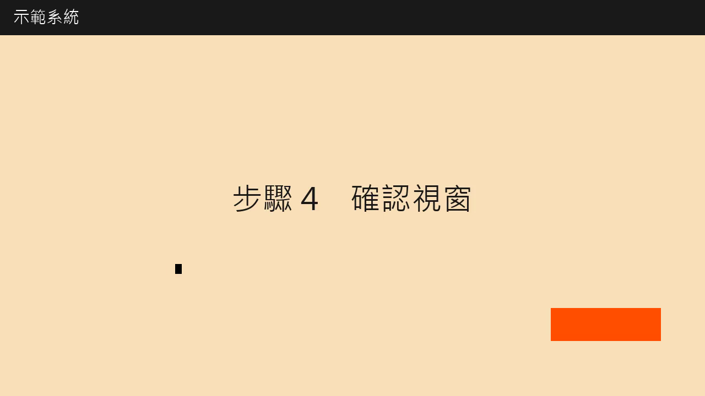
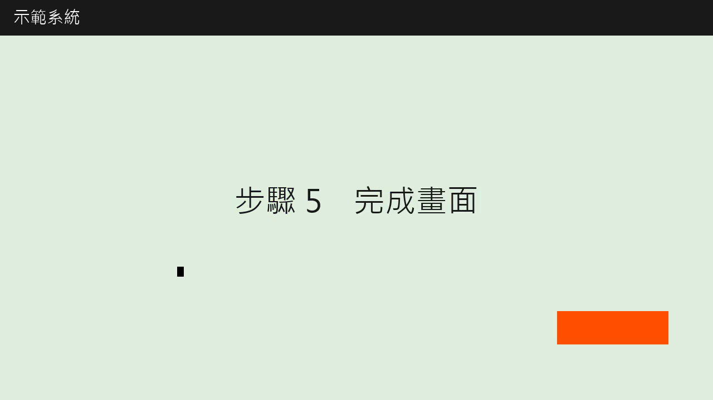

# 示範系統：新增訂單

> 製作：示範作者｜製作時間：2026-11-27 10:00

> 讀者：同事

這份手冊示範如何在示範系統中新增一筆訂單。

## 第 1 步：開啟示範系統，進入登入頁。

## 第 2 步：登入後會看到首頁儀表板。

## 第 3 步：點選右下角橘色按鈕，開啟「新增訂單」表單。

## 第 4 步：填完表單後送出，系統跳出確認視窗。

## 第 5 步：確認後出現完成畫面，訂單新增完成。

## 注意事項

- 本範例畫面為 ffmpeg 產生的測試影片，非真實系統。
